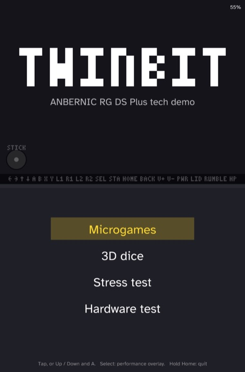
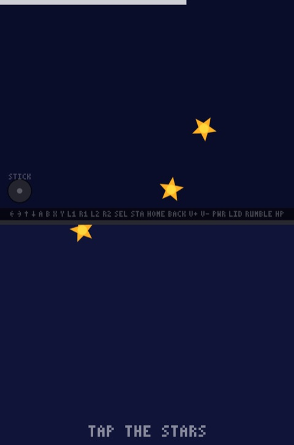
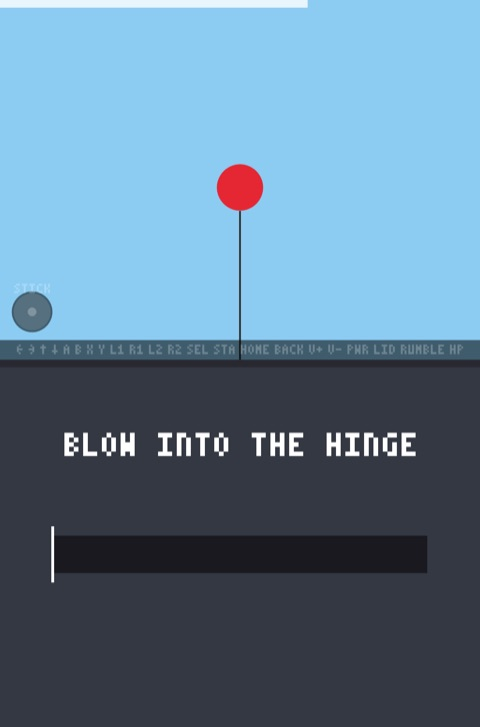
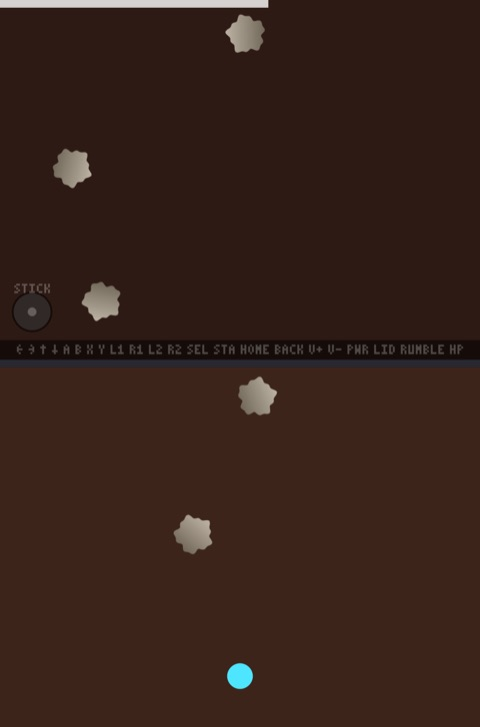
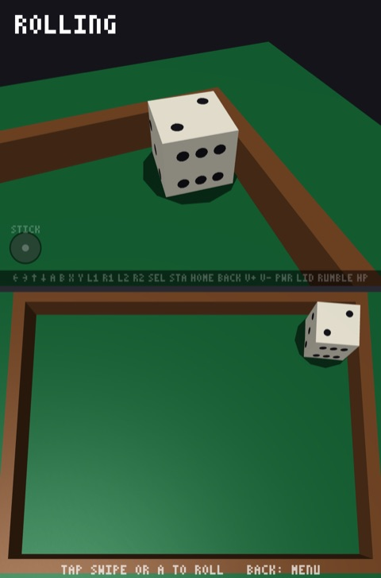
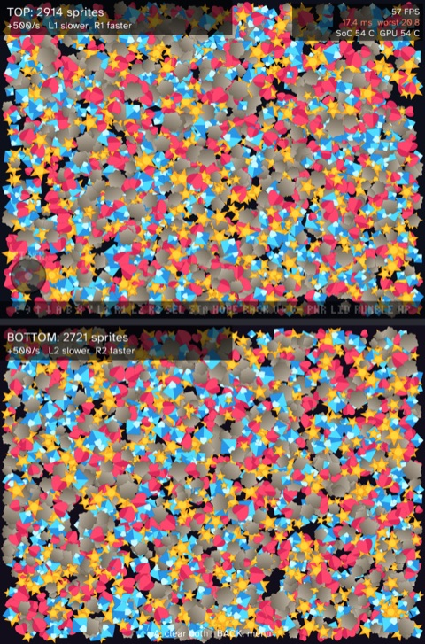
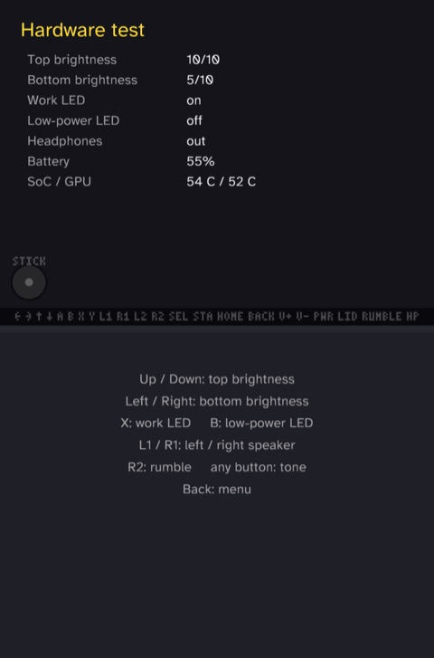

# twinbit-ds

A Rust tech demo for the ANBERNIC RG DS Plus. It is a test project, not a finished game. It gives a working example of every hardware feature, as a starting point for a real game.

<!-- template -->
## Start a new game

This repository is a GitHub template. Create a game from it, then rename it:

```sh
gh repo create my-game --private --template KyleJamesWalker/twinbit-ds --clone
cd my-game
scripts/rename.sh my-game
cargo test
git commit -m "chore: rename to my-game"
```

`scripts/rename.sh` replaces the name everywhere it appears: the crates, the binary, the `TWINBIT_*` environment variables, the device paths and debug pipe, the window titles, and the Ports launcher and its cover art. It then deletes itself and this section. The name must be lowercase letters, digits and hyphens, at most 15 characters.

The demo scenes stay in the copy. Keep, adapt or delete them as the new game needs.
<!-- /template -->

## Screenshots

Captured on the device with `scripts/debug.sh shot`. Each image shows the top screen above the bottom screen.

| Menu | Microgame: CATCH! | Microgame: BLOW! |
|---|---|---|
|  |  |  |
| **Microgame: DODGE!** | **3D dice** | **Stress test** |
|  |  |  |
| **Hardware test** | | |
|  | | |

## Overview

The title menu opens four scenes:

| Scene | What it exercises |
|---|---|
| Microgames | Short timed rounds that speed up as you score, with three lives. CATCH! drops stars from the top screen across the hinge, and you tap them on the bottom screen. BLOW! inflates a balloon from the hinge microphone. DODGE! steers with the d-pad or stick under falling rocks. |
| 3D dice | Lit 3D meshes on both screens: an overhead tray below and a chase camera above. Rigid body physics, swipe to throw, a clack and a rumble on each hard bounce. |
| Stress test | Bouncing sprites on each screen at a spawn rate you set per screen, to find where 60 FPS breaks. |
| Hardware test | Per-screen brightness, both LEDs, each speaker, the motor, battery, SoC and GPU temperature, and the headphone jack. |

Every scene also has these features:

- A strip on the top screen lights each input while you hold it, plus the lid, the motor and the headphones. A gauge shows the stick position.
- Each finger on the bottom screen gets a numbered ring, up to 10 at once.
- Select toggles a performance overlay with FPS, frame times and temperatures.
- Closing the lid pauses the game and turns both backlights off.
- The power button suspends the device, and the game resumes where it left off.
- Plugging in headphones moves the audio to them.
- Volume, brightness and the best microgame run persist between launches.

The same code also builds and runs on macOS for quick iteration.

## Requirements

- Rust 1.94 or later, with the `aarch64-unknown-linux-gnu` target.
- [cargo-zigbuild](https://github.com/rust-cross/cargo-zigbuild) and [Zig](https://ziglang.org) for the device build.
- An RG DS Plus on the stock firmware, with SSH turned on and reachable as `anbernic.local`. Set `RGDS_HOST` to use a different host.
- Key-based SSH login to the device. The stock root password is `root`, so run `ssh-copy-id root@anbernic.local` once.

## Setup

```sh
rustup target add aarch64-unknown-linux-gnu
scripts/sysroot.sh        # copy the device's libasound for linking
```

## Usage

Run on macOS:

```sh
cargo run -p twinbit
```

Build, copy and start on the device:

```sh
scripts/deploy.sh
CAPTURE=1 scripts/deploy.sh   # also log every input device and the lid sensor
ssh root@anbernic.local tail -f /userdata/twinbit/run.log
```

Install into the stock menu as Ports > Twinbit:

```sh
scripts/install.sh
```

Run the tests:

```sh
cargo test
```

### Controls

| Action | Device | macOS |
|---|---|---|
| D-pad | D-pad or stick | Arrow keys |
| A / B / X / Y | A / B / X / Y | X / Z / S / A |
| L1 / R1 / L2 / R2 | Shoulders | Q / W / 1 / 2 |
| Start / Select | Start / Select | Enter / Backspace |
| Touch | Stylus or finger on the bottom screen | Mouse on the bottom window |
| Blow | Hinge microphone | Microphone, or hold Space |
| Volume | V+ / V- | = / - |
| Lid | Close the lid | C toggles |
| Sleep and wake | Power button | None |
| Performance overlay | Select | Backspace |
| Back to the menu | Back | Tab |
| Quit | Hold Home for one second | Esc |

In the menu, tap a row or use Up, Down and A. Each scene lists its own controls on screen:

- **3D dice:** tap or press A for a random throw, or swipe to throw in that direction.
- **Stress test:** L1 and R1 set the top screen's spawn rate, L2 and R2 the bottom's, and A clears both.
- **Hardware test:** Up and Down set the top brightness, Left and Right the bottom. X and B toggle the work and low-power LEDs. L1 and R1 play the left and right speaker, R2 runs the motor, and any other button plays a tone.

### Debug mode

`DEBUG=1 scripts/deploy.sh` starts the game with a control pipe at `/tmp/twinbit.ctl`. `scripts/debug.sh` drives it over SSH:

```sh
scripts/debug.sh scene dice                 # open a scene
scripts/debug.sh press a 120                # hold a button for 120 ms
scripts/debug.sh tap 500 400                # touch the bottom screen
scripts/debug.sh swipe 300 650 650 250 120  # drag over 120 ms
scripts/debug.sh shot out.png               # save both screens, top above bottom
scripts/debug.sh sleep 5                    # suspend, then wake on the RTC alarm
scripts/debug.sh panic                      # crash on purpose to test crash.log
scripts/debug.sh logs                       # follow the game log, with a perf line each second
```

The scene names are `micro`, `stars`, `balloon`, `dodge`, `dice`, `stress` and `hardware`. The `stars`, `balloon` and `dodge` scenes start a microgame run on that microgame. On macOS, set `TWINBIT_DEBUG=1` and write commands to the pipe directly.

### Environment variables

| Variable | Effect |
|---|---|
| `TWINBIT_START` | Opens a scene at launch, by debug scene name. |
| `TWINBIT_DEBUG` | Turns on debug mode. `DEBUG=1 scripts/deploy.sh` sets it. |
| `TWINBIT_LOG_INPUT` | Logs every gamepad event. `CAPTURE=1 scripts/deploy.sh` sets it. |
| `TWINBIT_SAVE` | Sets the save file path. |
| `TWINBIT_TOP` | Names the output for the top screen, such as `DSI-2`. |
| `RGDS_HOST` | Sets the SSH target for the scripts. The default is `root@anbernic.local`. |

### Saves and crashes

The game keeps `save.txt` and `crash.log` next to its binary: `/mnt/sdcard/PORTS/twinbit` when launched from Ports, `/userdata/twinbit` in a dev run. It writes the save through a synced temp file and a rename, one second after the last change. Each panic appends a backtrace to `crash.log`.

## Performance

Measured on the device with the debug perf log, 4x MSAA, both screens at 1024x768:

| Load | Frame rate |
|---|---|
| Menu, microgames, 3D dice, hardware test | 60 FPS |
| Stress test, up to about 2,200 sprites per screen | 60 FPS |
| Stress test, about 4,700 sprites per screen | 30 FPS |
| Stress test, about 15,000 sprites per screen | 9 FPS |

Above about 2,200 sprites per screen, frame time grows linearly with the sprite count.

## Layout

| Path | Contents |
|---|---|
| `crates/game` | Scenes, input model, dice physics, 3D meshes, save format, bitmap font. No platform dependencies. |
| `crates/render` | OpenGL renderer for shapes, sprites, TrueType text and lit 3D meshes: GL 3.3 on macOS, GLES 3.0 on the device. |
| `crates/app` | Windows, input, audio, mic, saves, crash log, debug mode, and the device-only sysfs and evdev code. |
| `scripts` | Cross-compile, sysroot, deploy, install and debug scripts, and the on-device run script. |
| `assets` | The sprite sheet, the font and its license, and the Ports launcher with its cover art. |
| `docs/screenshots` | The screenshots above. |

## Device notes

The stock firmware runs Weston with one output per panel. DSI-1 is the top screen and DSI-2 is the bottom screen, and each takes a fullscreen window. The game swaps them when the system screen-swap setting (`lcdswap`) is on. Rendering uses GLES 3.0 on the Mali-G52 through EGL on Wayland.

| Hardware | Interface |
|---|---|
| Buttons, stick, d-pad | evdev `ANBERNIC-rk3568-keys`. Weston does not forward this device. |
| Back key | evdev `adc-keys`, `KEY_BACK` |
| Power key | evdev `rk805 pwrkey`, `KEY_POWER`. A press runs the stock `/mnt/vendor/ctrl/pwr_new.sh` to suspend. |
| Touch | Wayland touch events from the `gt9xx` panel, up to 10 fingers. The stock menu sets `/sys/class/anbernic_misc/tpctrl` to `1` when it launches a port, which stops Weston from delivering touches, so the game sets it to `0`. |
| Lid | `/sys/class/anbernic_misc/hallkey`: `3` open, `2` closed |
| Vibration motor | `/sys/class/anbernic_misc/moto`: `1` on, `0` off |
| Microphone and speakers | ALSA through PulseAudio. The game plays stereo and records from the `default` source. |
| Headphone jack | `/sys/class/extcon/*/state` for `rk817-sound`, `HEADPHONE=1`. Its evdev switch device never sends events. The game moves audio between the PulseAudio sinks `alsa_output.1.stereo-fallback` (speakers) and `alsa_output.0.HiFi__Speaker__sink` (headphones). |
| Backlights | `/sys/class/backlight/backlight` (top) and `backlight1` (bottom), 0 to 255. `bl_power` `4` turns a panel off. |
| LEDs | `/sys/class/anbernic_misc/work_led` and `lowpwr_led`, `1` on, `0` off. Both on shows orange. |
| Battery | `/sys/class/power_supply/cw2015-battery`. The startup scripts select this fuel gauge over the PMU's `battery`. |
| Temperature | `/sys/class/thermal`, zones `soc-thermal` and `gpu-thermal`, in millidegrees |
| Wake alarm | `/sys/class/rtc/rtc0/wakealarm` |

The button codes do not follow the evdev gamepad layout. For example, Start reports `BTN_TR` and A reports `BTN_SOUTH`. `crates/app/src/device.rs` holds the full map.

On exit, the game hands the backlights, LEDs and touch mode back the way it found them.

When the stock menu launches a port, the frontend exits first and restarts afterwards. `scripts/deploy.sh` runs the game over SSH instead, so the on-device `run.sh` pauses the frontend to stop its idle timer from suspending the device. The timer keeps counting while paused, so resuming the frontend can suspend the device at once. For that reason a crash restarts the game, and only a clean quit hands control back.
